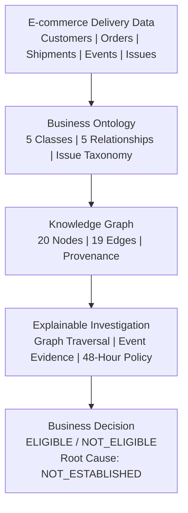

# L0 — E-commerce Delivery Ontology Lighthouse

## Part 1: CP01–CP05

## Business Objective

Investigate delayed e-commerce deliveries using explicit business
relationships, recorded classifications, and timestamped evidence.

## Architecture Principles

- Business ontology defines entities and their relationships.
- Knowledge graph materializes navigable business relationships.
- Graph traversal retrieves delivery context and event evidence.
- Deterministic SQL evaluates the inactivity policy.
- Issue classification does not independently establish root cause.
- Part 1 does not use Cortex Agents, LLM inference, or MCP.

## Demonstration Baseline

- 5 ontology classes
- 5 relationship types
- 4 issue taxonomy mappings
- 20 graph nodes
- 19 graph edges
- 3 investigated orders
- 4 passing boundary tests

## Part 2 — Future Scope

Semantic access, Cortex Agent integration, tools, and MCP
will be addressed in CP06–CP10.
