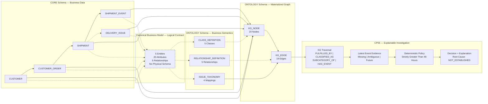

# L1 — Snowflake Ontology Technical Architecture

## Scope

Part 1 (CP01–CP05): deterministic, SQL-based ontology and
knowledge graph investigation of e-commerce delivery delays.

Database: `ECOM_ONTOLOGY_LIGHTHOUSE_DB`

## Canonical Business Model Alignment

The Canonical Business Model was introduced retrospectively
after CP01–CP05 as a logical business contract.

It defines five business entities, 20 attributes, and five
relationships aligned with the existing CORE physical schema
and ONTOLOGY metadata.

In the diagram, dashed links involving the canonical layer
represent logical alignment, not physical data movement.

The 20 semantic property definitions are stored in
`ONTOLOGY.CLASS_DEFINITION.PROPERTIES` as VARIANT metadata.
There is no separate PROPERTY_DEFINITION table.

CP04 continues to materialize KG_NODE and KG_EDGE directly
from CORE tables and ONTOLOGY.ISSUE_TAXONOMY.

CP05 continues to query existing CORE and ONTOLOGY objects.

No CANONICAL schema, additional transformation pipeline,
or KG rebuild is required.

Supporting documents:

- [Canonical Business Model](canonical_business_model.md)
- [Canonical-to-Physical Mapping](canonical_physical_mapping.md)
- [Canonical-to-Ontology Alignment](canonical_ontology_alignment.md)
- [Canonical-to-KG Traceability](canonical_kg_traceability.md)
## Business Relationships

| Relationship | Source | Target | Meaning |
|---|---|---|---|
| PLACED | CUSTOMER | CUSTOMER_ORDER | Customer places an order |
| FULFILLED_BY | CUSTOMER_ORDER | SHIPMENT | Order fulfilled by shipment |
| HAS_EVENT | SHIPMENT | SHIPMENT_EVENT | Shipment has tracking evidence |
| CLASSIFIED_AS | SHIPMENT | DELIVERY_ISSUE | Recorded issue classification |
| SUBCATEGORY_OF | DELIVERY_ISSUE | DELIVERY_ISSUE | Issue taxonomy hierarchy |

## Materialization

`sql/cp04_kg_materialization.sql` constructs graph nodes and
edges using source-derived identifiers and deterministic SHA-256
edge identifiers. Provenance is recorded for every edge.

The insert-only MERGE approach is rerunnable but does not remove
stale nodes or edges when source records are deleted or changed.

## Investigation

`sql/cp05_investigation.sql` traverses graph relationships,
retrieves shipment events, identifies latest-event evidence,
and evaluates the inactivity policy.

Evaluation time: `2026-10-12 12:00:00` (TIMESTAMP_NTZ).

Eligibility requires:
- Shipment status AT_WAREHOUSE.
- Recorded issue ISS_005 (Warehouse Inactivity).
- Latest event status AT_WAREHOUSE.
- Inactivity strictly greater than 48 hours.

Missing, ambiguous, and future event evidence are handled
explicitly. Delivered shipments are NOT_ELIGIBLE.

A recorded issue is not proof of operational root cause.
Root cause remains NOT_ESTABLISHED.

## Implementation Boundary

Part 1 does not include a Snowflake Semantic View, Cortex Agent,
LLM reasoning, or MCP integration. These are planned for Part 2
(CP06–CP10).

## Reproducibility Notes

- CP01–CP04 SQL files have been source-verified.
- CP05 investigation executed successfully for three orders.
- CP05 boundary acceptance tests passed 4/4.
- Clean-environment deployment remains to be tested.
