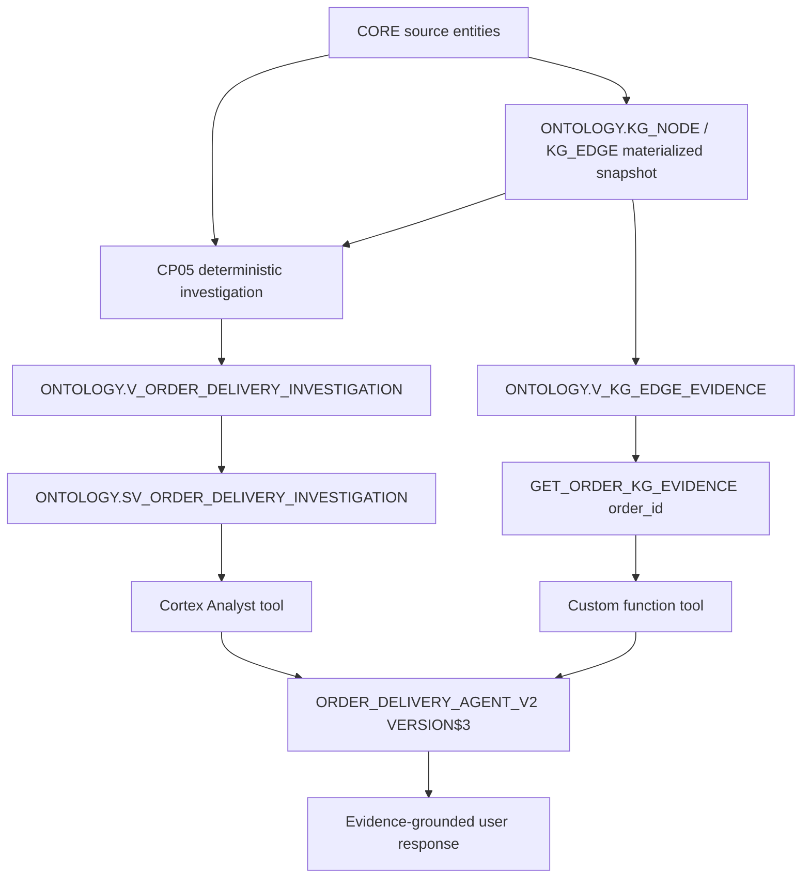

# Architecture — Part 2

## Responsibility boundaries

| Layer | Responsibility |
|---|---|
| CORE | Customer, order, shipment, event and issue source records |
| Canonical model | Logical mapping / normalization contract (retrofitted in Part 1; not a second set of physical tables) |
| ONTOLOGY metadata | Class definitions, relationship definitions, issue taxonomy |
| Knowledge Graph | Materialized node/edge representation and provenance |
| Deterministic investigation | Fixed-time eligibility policy and conservative root-cause status |
| Semantic View | Governed business dimensions and metrics; does not traverse KG independently |
| Cortex Analyst | Natural-language to governed analytical SQL |
| Custom KG tool | Relationship evidence and provenance for a specific order |
| Cortex Agent | Orchestrates the two tools, without equating classification to causation |

**Known limitation:** graph snapshots require an explicit refresh and validation strategy before use in a changing production dataset. This demonstration does not implement such a synchronization mechanism.
